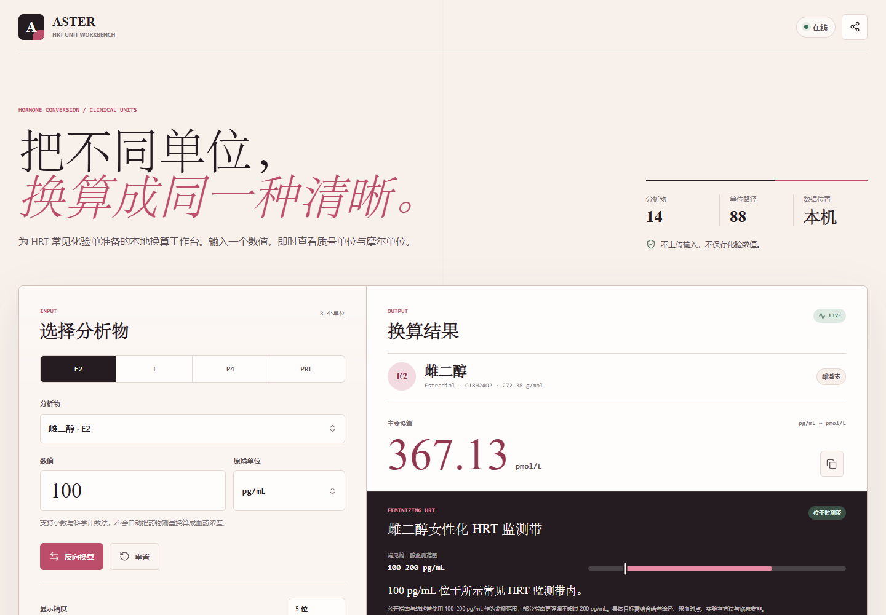

# ASTER · HRT 激素单位换算器

## 2.0 新增：批量换算工作表

在主换算器下方逐项添加分析物、数值、原始单位和目标单位，也可以「加入当前换算」。支持最多 50 项，可分别移除或一次清空。每项均使用对应分析物的现有公式；批量结果不做临床解释。

所有条目有效后才能导出 CSV，避免遗漏错误项。CSV 包含原数值、原单位、未按显示精度截断的换算值、目标单位，以及催乳素使用的实验室系数。精度和催乳素系数与主换算器一致；若导入不同实验室的报告，请分别核对系数。

批量内容只保存在当前页面内存，刷新或关闭即清空，不加入分享链接或浏览器存储；需要留存时请主动导出。v2.0 同时修复了共用 GitHub Pages 域名时离线缓存互相清理、指南覆盖首页与失败页面污染缓存的问题。详见 [CHANGELOG.md](CHANGELOG.md)。

ASTER 是一款隐私优先、离线可用、面向 HRT 场景的激素化验单位换算器。它支持 14 种常见分析物与 80 余条单位映射，覆盖雌二醇、雌酮、雌三醇、炔雌醇、总睾酮、游离睾酮、DHT、孕酮、雄烯二酮、DHEA-S、催乳素、LH、FSH 与 SHBG。



> **工具边界：** ASTER 只做化验单位换算，不做药物剂量到血药浓度的推算，也不判断结果高低或提供治疗建议。参考区间必须以你的实验室报告与临床医生意见为准。

## 功能

- 实时双向换算，支持质量浓度、摩尔浓度和免疫测定国际单位
- 女性水平对照：周期分期、绝经后与年龄相关参考带同时展示
- 女性化 HRT 监测对照：雌二醇常见 `100–200 pg/mL` 监测带与总睾酮 `<50 ng/dL` 上限
- 每种激素使用独立分子信息，避免把 E2、E1、E3、EE2、T 与 DHT 混用
- 催乳素提供可调整的免疫测定近似系数，默认 `21.2 mIU/L = 1 ng/mL`
- 复制单项结果、复制全部结果或分享当前换算链接
- 小数、科学计数法与 3 至 7 位有效数字显示
- 响应式界面，适配手机、平板和桌面
- PWA 安装与离线缓存，不依赖远程字体、分析脚本或后端
- GitHub Pages、Netlify、Vercel、Docker 与普通静态服务器部署配置

## 支持的分析物

| 分类 | 分析物 | 常用单位 |
| --- | --- | --- |
| 雌激素 | 雌二醇 E2 | `pg/mL`, `pmol/L` |
| 雌激素 | 雌酮 E1 | `pg/mL`, `pmol/L` |
| 雌激素 | 雌三醇 E3 | `ng/mL`, `nmol/L` |
| 雌激素 | 炔雌醇 EE2 | `pg/mL`, `pmol/L` |
| 雄激素 | 总睾酮 T | `ng/dL`, `nmol/L` |
| 雄激素 | 游离睾酮 FT | `pg/mL`, `pmol/L` |
| 雄激素 | 双氢睾酮 DHT | `pg/mL`, `pmol/L` |
| 孕激素 | 孕酮 P4 | `ng/mL`, `nmol/L` |
| 雄激素前体 | 雄烯二酮 A4 | `ng/dL`, `nmol/L` |
| 肾上腺雄激素 | DHEA-S | `µg/dL`, `µmol/L` |
| 垂体激素 | 催乳素 PRL | `ng/mL`, `mIU/L` |
| 垂体激素 | 促黄体生成素 LH | `mIU/mL`, `IU/L` |
| 垂体激素 | 促卵泡激素 FSH | `mIU/mL`, `IU/L` |
| 结合蛋白 | SHBG | `nmol/L`, `µmol/L` |

完整公式、分子量和方法学边界见 [MODEL.md](MODEL.md)。

## 本地运行

只需要 Node.js 18 或更高版本，不需要安装依赖。

```bash
node scripts/serve.mjs
```

打开 `http://127.0.0.1:4180`。

运行检查与测试：

```bash
node --check assets/app.js
node --test
```

## 部署

### GitHub Pages

1. 将项目推送到 GitHub 的 `main` 分支。
2. 打开仓库 `Settings → Pages`。
3. 将 Source 设为 `GitHub Actions`。
4. `.github/workflows/pages.yml` 会在测试通过后部署静态站。

### Netlify

仓库已包含 `netlify.toml`。在 Netlify 导入仓库后无需构建命令，发布目录使用项目根目录。

### Vercel

仓库已包含 `vercel.json`。在 Vercel 导入仓库后选择 `Other`，无需 Build Command，Output Directory 保持项目根目录。

### Docker

```bash
docker build -t aster-hrt-converter .
docker run --rm -p 8080:80 aster-hrt-converter
```

打开 `http://127.0.0.1:8080`。

### 任意静态托管

将项目根目录中的以下文件原样上传即可：

```text
index.html
manifest.webmanifest
sw.js
robots.txt
assets/
src/
```

不要只上传 `index.html`，否则 ES 模块、样式、图标与离线缓存不会工作。

## 项目结构

```text
.
├── assets/
│   ├── app.js
│   ├── icon.svg
│   ├── lucide.min.js
│   └── styles.css
├── licenses/
├── scripts/
│   └── serve.mjs
├── src/
│   ├── converter.js
│   ├── female-ranges.js
│   └── hrt-targets.js
├── tests/
│   └── converter.test.js
├── .github/workflows/pages.yml
├── index.html
├── guide.html
├── manifest.webmanifest
├── MODEL.md
├── netlify.toml
├── sw.js
└── vercel.json
```

## 隐私

输入数值不会上传。应用不包含账号系统、分析脚本、远程接口或数据库。浏览器只保存分析物、单位、精度和催乳素系数的偏好，不保存输入的激素数值。

## 医学边界

- 不同实验室、检测平台、校准品和采样时点可能产生不同结果。
- `pg/mL`、`ng/mL`、`pmol/L` 与 `nmol/L` 之间的换算属于数学换算，不代表结果可直接跨实验室比较。
- LH 与 FSH 的国际单位不能根据通用蛋白质质量换算为 `ng/mL`。
- 催乳素的质量单位与 `mIU/L` 比值依检测系统而异。
- 药品 `mg`、凝胶 `mg/g`、贴片 `mcg/day` 等是药物或制剂剂量，不能直接代入血清浓度换算。
- 雌二醇 `100–200 pg/mL` 与总睾酮 `<50 ng/dL` 是常见 HRT 监测参照，不是保证女性化效果的阈值，也不替代个体化处方。

主要公开资料：

- [Endocrine Society 2017 Gender Dysphoria/Gender Incongruence Guideline](https://www.endocrine.org/clinical-practice-guidelines/gender-dysphoria-gender-incongruence)
- [WPATH Standards of Care Version 8](https://wpath.org/publications/soc8/)
- [Estradiol Concentrations for Adequate Gender-Affirming Feminizing Hormone Therapy (2025 systematic review)](https://doi.org/10.1089/lgbt.2024.0407)

## 许可

源代码采用 MIT License。Lucide 图标采用 ISC License，完整文本见 [THIRD_PARTY_NOTICES.md](THIRD_PARTY_NOTICES.md)。
